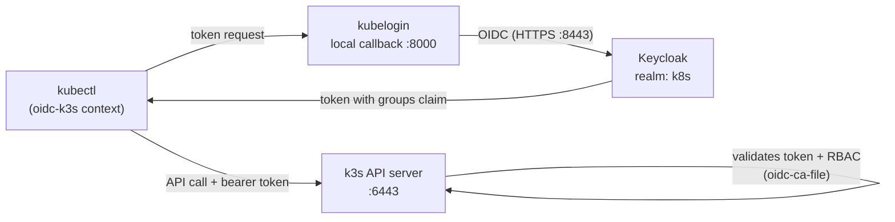

# K3s + Keycloak OIDC (TLS)

**Configure standalone k3s** (not k3d) **with Keycloak OIDC over HTTPS** using a self-signed certificate — from zero to a `kubectl` login that goes through Keycloak, with RBAC mapped from realm roles.

## How the pieces connect

- **Keycloak** issues the tokens (authentication).
- **kubelogin** handles the browser dance for `kubectl` (the `:8000` redirect is its local callback — not Keycloak).
- **The k3s API server** validates those tokens against Keycloak's certificate and maps the `groups` claim to RBAC (authorization).

## The path

1. [Prerequisites and TLS certificates](01-prereqs-and-certs/)
2. [Run Keycloak with HTTPS](02-keycloak-https/)
3. [Install K3s with OIDC and configure the realm](03-k3s-and-realm/)
4. [First login, RBAC, and troubleshooting](04-login-and-rbac/)

{: .note }
Development-grade credentials are used throughout (`admin/admin`, self-signed certs). Fine for a lab node; never for anything reachable from outside.
