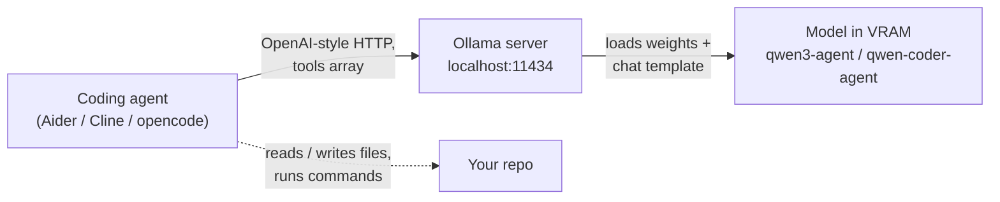

# Run LLMs Locally

**Cloud LLM = eating at a restaurant.** Convenient, but you pay per plate and the chef sees your order. **Running locally = cooking at home** — you buy the ingredients once (model weights), your kitchen is your GPU, and nobody sees what's on your plate.

This guide runs large language models on your own machine using [Ollama](https://ollama.com), tested end-to-end on a ThinkPad P16v Gen2 with an NVIDIA RTX 1000 Ada (6 GB VRAM). Every step is sized for that 6 GB ceiling — and every number should be *measured on your node*, not trusted from spec sheets.

## How the pieces connect

- **The agent** is the driver — it decides *what* to do.
- **Ollama** is the engine — it serves the model over HTTP.
- **The model** is the brain — which model you pick decides whether it can *call tools*, not just chat.

## Three ideas that decide everything else

1. **Two different jobs, two different models.** Autocomplete (finishing your code as you type) and agentic tool-calling (deciding "I need to run this command") are different skills. Conflating them is the #1 way to be disappointed by a "coding model" that chats fine but can't drive an agent.
2. **VRAM is the hard wall.** A 6 GB card has roughly 4–4.5 GB usable for model + context after OS overhead and a safety margin.
3. **Measure, don't trust.** Laptop GPUs consistently underperform desktop parts with similar names — the benchmark script in this guide replaces guesses with real numbers.
